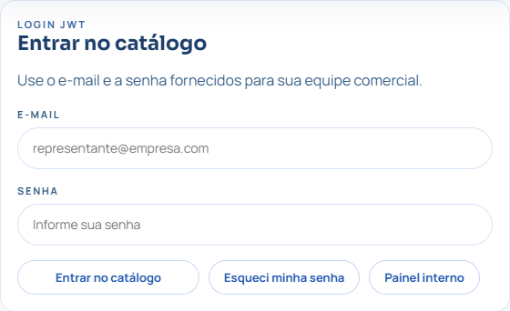
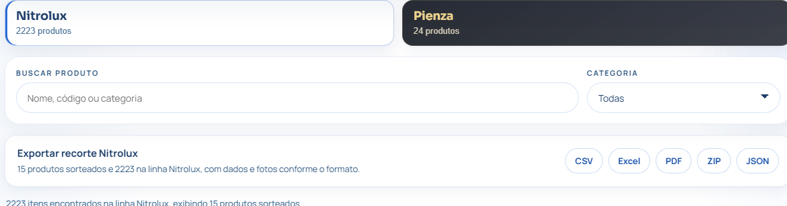
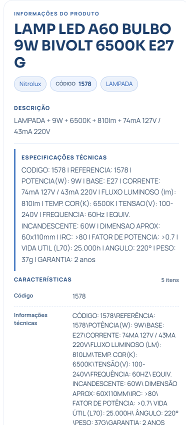

# Guia do representante

Catálogo digital Nitrolux e Pienza • Edição 16/10/2026

## O catálogo no seu atendimento

Consulte produtos Nitrolux e Pienza, confira as informações disponíveis e baixe materiais para apoiar a apresentação ao cliente. Acesse pelo navegador do celular, tablet ou computador.

[Abra o catálogo](https://catalogo-nitrolux-ten.vercel.app)

### Entre com o seu acesso individual

1. Abra o endereço acima no navegador.
2. Preencha **E-mail** e **Senha** com os dados fornecidos pela equipe responsável pelo seu acesso.
3. Toque ou clique em **Entrar no catálogo**.

**Ainda não recebeu seu login?**

Solicite o cadastro à equipe comercial responsável. A tela de entrada é destinada a usuários que já receberam suas credenciais.

Depois de entrar, escolha a marca, localize o produto e abra os detalhes. A área **Painel interno** é destinada à administração; ela não é necessária para consultar o catálogo.

**Cuide do seu acesso:** não compartilhe sua senha. Ao terminar em um dispositivo compartilhado, use **Sair**.

## Encontre o produto certo

A busca e a categoria trabalham dentro da marca selecionada. Confira a aba antes de procurar um item.

1. **Escolha a marca.** Clique em **Nitrolux** ou **Pienza**.
2. **Use Buscar produto.** Digite o código, parte do nome ou uma categoria. Quando souber o código, use-o para localizar o item com mais precisão.
3. **Refine em Categoria.** Selecione a categoria desejada. A busca e a categoria podem ser usadas juntas.
4. **Abra o item.** Clique no cartão ou em **Ver produto e fotos** para consultar os detalhes.
5. **Veja mais resultados.** Quando o botão **Carregar mais … produtos** estiver disponível, use-o para ampliar a lista exibida.

**A tela inicial mostra uma seleção**

Sem busca e com Categoria em Todas, a página apresenta produtos sorteados. Essa seleção não representa todo o catálogo. Use a busca ou escolha uma categoria para procurar um item específico.

### Exemplo de consulta

Selecione **Nitrolux**, digite **1578** em **Buscar produto** e abra o resultado correspondente. O código é um exemplo presente nas telas deste guia; use o código do produto que deseja consultar.

**Não encontrou?** Apague o texto da busca, volte a Categoria para **Todas** e confira se a marca selecionada está correta.

## Confira antes de compartilhar

Na tela do produto, confira a identificação e as informações cadastradas antes de baixar ou encaminhar um material.

### O que consultar

- **Nome, marca e código:** confirme se o produto é o solicitado pelo cliente.
- **Descrição:** leia o resumo do item.
- **Especificações técnicas:** confira os dados exibidos para aquele produto.
- **Características:** consulte os campos adicionais disponíveis no cadastro.

### Como usar as fotos

1. Role até **Outras fotos**.
2. Selecione uma miniatura para mudar a imagem principal, quando houver fotos disponíveis.
3. Use **Baixar foto selecionada** para salvar a imagem atual ou **Baixar todas em ZIP** para solicitar o pacote.

### Ficha do produto

Em **Baixar este produto**, escolha **Ficha técnica** para baixar o PDF do item aberto. Confira o arquivo antes de enviá-lo ao cliente.

Se aparecer **Sem imagem**, consulte as demais fotos disponíveis ou informe o código do produto à equipe responsável. Para continuar a busca, clique em **Voltar ao catálogo**.

## Escolha o material para cada uso

Você pode baixar um produto individual ou exportar os resultados da marca, busca e categoria selecionadas.

| Opção | Quando usar |
| --- | --- |
| Ficha técnica | PDF do produto aberto, para apresentar as informações do item ao cliente. |
| PDF | Documento com os produtos e informações do recorte escolhido. |
| Excel | Planilha para organizar e consultar os dados dos produtos. |
| CSV | Arquivo de dados para abrir em planilhas ou utilizar em outros sistemas. |
| ZIP | Pacote com dados e fotos disponíveis, conforme o conteúdo da exportação. |
| JSON | Dados estruturados; use quando esse formato for solicitado. |

### Para baixar um único produto

Abra o produto e use os botões de **Baixar este produto**. Para enviar apenas uma imagem, use **Baixar foto selecionada** na galeria.

### Para exportar uma seleção

1. Escolha **Nitrolux** ou **Pienza**.
2. Ajuste **Buscar produto** e **Categoria** para definir o conteúdo desejado.
3. Em **Exportar recorte Nitrolux** ou **Exportar recorte Pienza**, escolha o formato.
4. Aguarde o download. Localize o arquivo na pasta de downloads do dispositivo e confira o conteúdo antes de compartilhar.

**A exportação acompanha os filtros**

O arquivo considera a marca, a busca e a categoria selecionadas, mesmo quando a grade mostra apenas parte dos resultados. Para exportar só um item, abra esse produto e use Baixar este produto.

**Dica para o atendimento:** localize o código, confira os detalhes, baixe a ficha técnica ou a foto necessária e encaminhe o arquivo ao cliente pelo canal que você já utiliza. Compartilhar um link do catálogo pode exigir que o destinatário tenha acesso próprio.

## Resolva as dúvidas mais comuns

Mantenha seu e-mail de acesso e o código do produto em mãos quando precisar de ajuda. Não envie sua senha.

### Esqueci minha senha

1. Solicite um **código de recuperação** ao administrador do catálogo.
2. Na tela de entrada, clique em **Esqueci minha senha**.
3. Preencha seu e-mail, o código recebido, **Nova senha** e **Confirmar nova senha**.
4. Use uma nova senha com **pelo menos 10 caracteres** e clique em **Alterar senha**.
5. Volte ao login e entre com a nova senha. Se o código não funcionar, solicite orientação ao administrador.

| Situação | O que fazer |
| --- | --- |
| E-mail ou senha incorretos | Confira o e-mail cadastrado e os dados digitados. Se necessário, use a recuperação de senha. |
| O sistema pediu login novamente | Entre novamente com suas credenciais. Isso pode acontecer quando a sessão expira. |
| Nenhum item encontrado | Confira a marca, apague a busca e selecione Todas em Categoria. |
| Foto não carregou | Aguarde o carregamento e verifique a conexão. Se continuar, informe o código do item à equipe responsável. |
| Download não apareceu | Verifique a pasta de downloads do navegador. Se necessário, tente novamente com um recorte menor. |
| Serviço temporariamente indisponível | Aguarde e tente novamente. Se persistir, envie a mensagem do erro à equipe responsável. |

**Como pedir suporte**

Informe seu e-mail de acesso, o código do produto quando houver, o que tentou fazer e a mensagem exibida. Você pode enviar uma captura da tela sem mostrar senha ou código de recuperação.

**Ao finalizar:** use **Sair**, principalmente em computadores compartilhados.

Guia de uso para representantes • Edição de 16/10/2026. As telas ilustram a versão consultada nessa data; os produtos e as imagens disponíveis podem variar com a atualização do catálogo.
